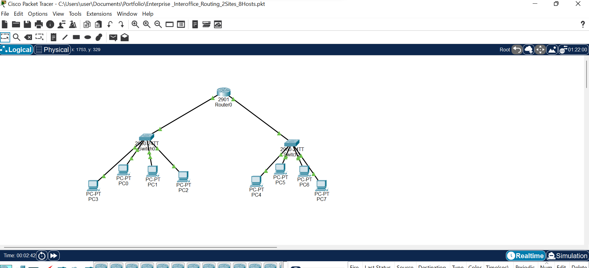
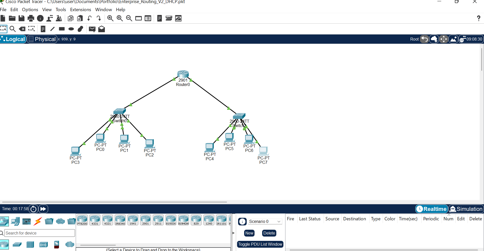

# Enterprise Network Lab - Interoffice Routing (2 Sites, 8 Hosts)

## Overview
Designed and implemented a multi-site enterprise network in Cisco Packet Tracer to simulate real interoffice connectivity. This lab covers IP planning, DHCP, routing, and end-to-end verification - core networking skills required for SOC/SIEM operations.

**Tools:** Cisco Packet Tracer, Cisco 2911 Router, Cisco 2960 Switches
**Devices:** 1 Router, 2 Switches, 8 PCs across 2 Sites

### Topology

### Lab Documentation

#### 1. IP Addressing Plan
Structured IP scheme for both sites with gateway planning.

#### 2. DHCP Configuration & Binding
Configured DHCP pool on 2911 router and verified bindings.

#### 3. DHCP Client Verification
Verified PCs received IP automatically from DHCP server.

#### 4. Connectivity Verification
Tested gateway ping and inter-site ping (Left to Right site).

### Configuration Summary
- Router-on-a-stick / Inter-VLAN routing
- DHCP server configuration on 2911
- Access port configuration on 2960 switches
- IP route verification
- Full connectivity testing (ping, traceroute)

### Files in this Repo
- `Enterprise_Interoffice_Routing_2Sites_8Hosts.pkt` - Main topology
- `Enterprise_Routing_V2_DHCP.pkt` - DHCP version
- IP plan, DHCP binding, and ping proofs

### Skills Demonstrated
- Enterprise Network Design & IP Planning
- Cisco Router & Switch Configuration
- DHCP & Dynamic IP Management
- Network Troubleshooting
- Documentation & Verification

### Relevance to SOC Analyst Role
Understanding network traffic flow (DHCP, routing, TCP) is critical for analyzing logs forwarded to SIEM platforms like Splunk (TCP 9997). See my other pinned repo: [Splunk SIEM Lab](https://github.com/Franklin-cybersec/splunk-siem-kali-authlog-lab)
